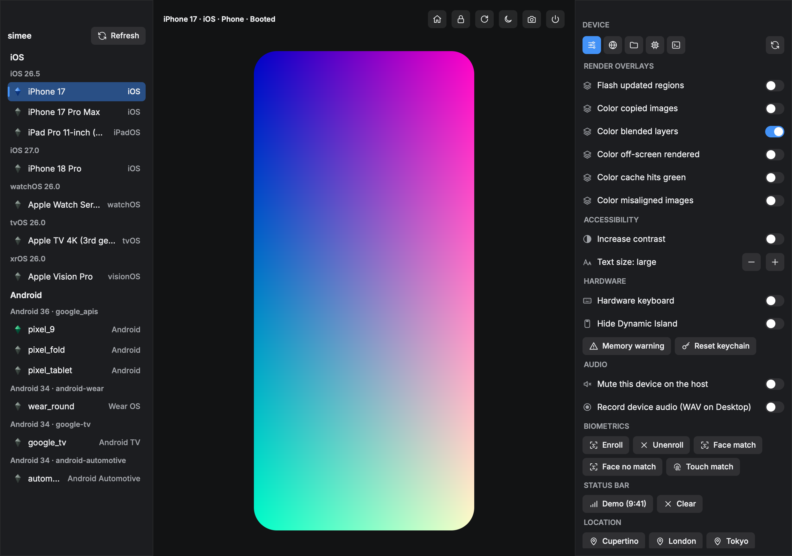

# simee


iOS simulators and Android emulators without Simulator.app or the SDK emulator: one Rust core, one
CLI, one JSON socket API and one desktop window for both platforms. Your existing tools keep
working, because each device looks like the stock one: `adb`, `adb emu`, `simctl` and test
harnesses drive it unchanged.



## Performance

Measured against the stock tools on the same host and day, medians of 3 or more; each links its
row and the script that reruns it (it creates and deletes its own devices).

- **Android boots 4.9× faster warm, 2.4× cold:** 3.5 s against the SDK emulator's 17.1 s to
  `sys.boot_completed`, 9.5 s against 22.9 s for a new AVD, with 45% less peak memory warm (2.09 against
  3.78 GB; 25% cold). M3 Max, 2026-11-24. [Row](docs/benchmarks.md#android-emu-against-the-sdk-emulator),
  `scripts/bench/android-boot.sh`.
- **Fewer janky frames:** 0% of the frames swiping a Pixel Tablet's launcher against 5.6%, though
  emu drew about 530 frames to stock's 1350 there; 0.25% against 6.2% on a phone, where both drew
  about 790. M3 Max, 2026-11-25. [Row](docs/benchmarks.md#frame-pacing),
  `scripts/bench/android-frames.sh`.
- **Cheaper idle devices:** an idle API 29 device costs 2.9% of a host core against 5.4%; API 30
  2.1% against 3.7%. M3 Max, 2026-11-26.
  [Row](docs/benchmarks.md#api-29-and-30-first-boots-and-idle-host-cpu), `scripts/bench/android-idle.sh`.
- **Android on Linux without KVM:** a warm boot in 168 s against `-accel off`'s 2302 s (one of its
  3 boots never finished in 40 minutes). 4-vCPU Xeon VM, 2026-11-26.
  [Row](docs/benchmarks.md#boot-to-sysboot_completed-with-emus-devices), `scripts/bench/software-mode.sh`.
- **iOS screenshots 17× faster as a command:** 36 ms through `simee serve` against 601 ms for
  `simctl io screenshot` (a loaded host, 1-minute load 13-69). M3 Max, 2026-11-26.
  [Row](docs/benchmarks.md#ios-simee-against-simctl), `scripts/bench/ios-command.sh`.

`scripts/bench/run-all.sh --list` names every benchmark behind the numbers on this page.

## Compared with the stock tools

### Android: emu against the SDK emulator

The same API 36 `google_apis` AVD (4 vCPU, 2 GB) under both, on one M3 Max, 2026-11-24, median
of 3 boots each. A cold boot is a new AVD's first; a warm boot is any later one, without a snapshot.

| | emu | SDK emulator |
| --- | --- | --- |
| Cold boot, until `sys.boot_completed` | **9.5 s** | 22.9 s |
| Warm boot, until `sys.boot_completed` | **3.5 s** | 17.1 s |
| Warm boot, until `adb` sees the device | **1.6 s** | 8.5 s |
| Peak memory, whole process tree, warm | **2.09 GB** | 3.78 GB |
| Janky frames swiping the launcher, Pixel Tablet / phone | **0% / 0.25%** | 5.6% / 6.2% |
| Java needed to provision an image | no | yes (`sdkmanager`) |

The SDK emulator restores a snapshot in 2.8 s; emu has no snapshots yet, and its warm boot is
within a second of that restore.

Guest code runs natively under both. The gap is the emulator itself: an
in-kernel interrupt controller, zero-copy disk and adb paths, and memory that is committed only
when the guest touches it.

### Android on Linux without KVM

Software mode, for cloud and CI machines with no `/dev/kvm` and no GPU: QEMU's TCG runs the
guest's CPU and emu serves its devices. The API 36 x86_64 image on a 4-vCPU Xeon VM with 8 GiB,
2026-11-26 ([benchmarks](docs/benchmarks.md#android-software-mode-linux-without-kvm)).

| | emu | SDK emulator, `-accel off` |
| --- | --- | --- |
| Warm boot, until `sys.boot_completed`, median of 3 or more | **168 s** | 2302 s (1 of 3 never finished in 40 minutes) |
| Host CPU once idle | **0.75 cores** | 1.09 cores |
| Peak memory, QEMU and emu | 3.29 GB | **3.12 GB** |
| Tap / screenshot through the API, median | **60.8 ms / 36.9 ms** | no display socket; its framework kept restarting |

The SDK emulator runs every vCPU on one translator thread, and emu's QEMU runs one per vCPU.
Everything is drawn on the CPU, so the launcher draws about 7 frames a second.

### iOS: simee against Simulator.app and `simctl`

| | simee | Simulator.app and `simctl` |
| --- | --- | --- |
| Booting a device | headless, no app window | opens Simulator.app, or `simctl boot` with no screen |
| Screenshot as a command, median (loaded host) | **36 ms** through `simee serve`, 173 ms alone | 601 ms (`simctl io screenshot`) |
| Touch, keys, buttons, Digital Crown, Siri Remote | CLI and API | by hand in the window |
| Network conditions | per device, per host, live, no root | Network Link Conditioner: whole Mac, needs install |
| Audio | capture or mute one device, no driver | host output only |
| Processes, sockets, traffic per process | listed per device, signalable | Activity Monitor, across the whole Mac |
| App containers and preferences | browse, read, write, clear | find the path yourself |
| Core Animation overlays, memory warning, Face ID | scriptable | Debug menu, by hand |
| CarPlay display | attach, touch, screenshot | window only |

Every row on the left is a CLI command, an API method and a control in the desktop window.

How each number was measured, the `scripts/bench/` command that reruns it, and what has not been
measured yet: [docs/benchmarks.md](docs/benchmarks.md). The full comparison:
[docs/comparison.md](docs/comparison.md).

## Quick start

Needs macOS on Apple silicon, Rust (pinned in `rust-toolchain.toml`) and, for iOS, Xcode with a
simulator runtime.

```bash
cargo build && alias simee=target/debug/simee

simee list                                   # every iOS and Android device
simee boot "iPhone 17"                       # headless; waits until it has booted
simee screenshot booted out.png
simee tap booted 600 1300
```

Android, with no Android Studio and no Java:

```bash
emu -provision 36 -tag google_apis            # platform-tools, the system image, the renderer
simee create Pixel --platform android --system-image "system-images;android-36;google_apis;arm64-v8a"
simee boot Pixel
adb -s emulator-5554 shell                    # an ordinary emulator to every tool
```

To put emu behind tools that launch `emulator` themselves: `make shim`, then
`export ANDROID_HOME=~/.simee/sdk`.

## What it covers

Phones, tablets, foldables, watches, TVs, cars and headsets on both platforms, each with its own
inputs (hinge, rotary, D-pad, Digital Crown, Siri Remote, vehicle properties, XR head pose).
Unsupported combinations are refused with the reason. The matrix and its gaps:
[docs/form-factors.md](docs/form-factors.md).

## Not yet

- iOS needs an Apple silicon Mac. Android runs on Apple silicon, and on x86_64 Linux in software
  mode (x86_64 images; slow frames, see above). KVM on Linux is in progress
  ([#54](https://github.com/kaeawc/simee/issues/54)).
- No Android snapshots, so every boot is a full boot.
- AutoMobile's Android harness: 38 of 41 tools pass (2026-11-24). Open: network shaping and VM
  snapshots.
- Automotive and Android XR images have their devices implemented but have not been booted.
- iOS microphone injection still needs a loopback audio device.
- Android system images below API 29 are refused with the reason; emu hasn't been brought up on
  them.
- Android guests reach the internet over IPv4 only (TCP, UDP, ping); no IPv6 or inbound port
  forwarding yet. IP fragments the guest sends are dropped, and DNS goes to the host's first
  resolver, not to a VPN's scoped one.

## Documentation

| | |
| --- | --- |
| [Comparison](docs/comparison.md) | what differs from the stock tools, and why |
| [Benchmarks](docs/benchmarks.md) | every published number and the command behind it |
| [CLI](docs/cli.md) and [API](docs/api.md) | commands and methods for both platforms |
| [MCP server](docs/mcp.md) | `simee mcp`: every method as a tool for an agent, with resources, tasks and a device view |
| [Debugging](docs/debugging.md) | the iOS debug surface, network shaping, audio, Android counters |
| [Desktop window](docs/desktop.md) | the window, its shortcuts and per-device controls |
| [Android backend](docs/android.md) | emu status, provisioning, performance notes |
| [Architecture](docs/architecture.md) | layers, process model, design decisions |
| [Development](docs/development.md) | requirements, checks against real devices |

## License

MIT
