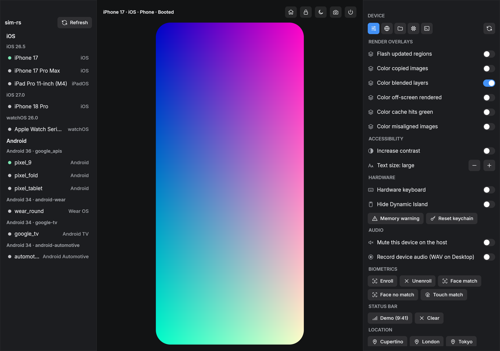

# Desktop window

One window for iOS and Android devices.



```bash
cd desktop
cargo run --release                     # SIMEE_DEVICE=<udid|name|booted> preselects a device
cargo run -- --snap shot.png --scene demo   # headless render; scenes: demo, android, foldable,
                                            # folded, tablet, ipad, watch, tv, apple-watch, apple-tv, empty
cargo run --release --features tooling -- --snap shot.png --scene demo   # the same, optimized
```

The window, the 3D device view included, draws with Rune's native Metal backend.
`SIMEE_GPU_BACKEND=wgpu` switches it to wgpu's Metal backend, and `metal` chooses the default. The
window looks and behaves the same on both, but wgpu costs a little more:
[benchmarks.md](benchmarks.md#desktop-runes-native-metal-backend-against-wgpu) and the
[3D view's costs](#3d-device-view) below. Rune's own `RUNE_GPU_BACKEND` overrides it.

## 3D device view

⌘3 switches the screen to a 3D view: the device's body (`sim_core::body`: phones, tablets,
foldables and watches) in perspective, lit, with its live screen on the screen face. It is drawn
with a depth buffer and 4x MSAA. `SIMEE_VIEW=3d` starts the window with it on. It draws on both
backends: Rune's native Metal backend, the default, has had depth attachments and MSAA resolves
since anomalyco/rune#2563 (#193), and wgpu's (`SIMEE_GPU_BACKEND=wgpu`) remains an option.
Headless renders of every scene (demo, android, foldable, folded, tablet, watch, turned) in the 3/4,
side, back and face-on views, and flat, are byte-identical on the two backends. A TV, head unit or
headset has no body and stays flat. With the 3D view off, the window is exactly the flat one:
screenshots are byte-identical to the build without it on both backends.

It starts in a 3/4 view from the right and above. `SIMEE_SCENE_CAMERA` starts it in another
saved view: `front`, `side` (edge on: thickness, keys, camera bump), `back` or `face`.

You move the camera with the pointer (#155):

| Input | Does |
|---|---|
| Drag beside the device (anywhere the pointer is an open hand) | Orbit: the body turns with the pointer; the tilt stops 80° above or below |
| ⇧-drag, or a two-finger trackpad drag | Pan: the body follows the fingers, up to half the stage off centre |
| Mouse wheel, ⌘-scroll, or pinch | Zoom, up to 4x in or out, though never so close that the camera enters the body |
| Two-finger trackpad rotation | Spins the device with the fingers (from the front or from behind), settling on the nearest quarter turn |
| ⌘0, or the toolbar's Face on | Face on: the screen at 1:1, exactly where the flat view draws it, with the device turned back upright and to the front |
| ⌘1, ⌘2, ⌘4, ⌘5 | Saved views: 3/4, front, side, back (⌘3 is the toggle) |
| ⌘F, or the toolbar's Flip | Turns the device over to its back, and again to its front |
| ⌘[ / ⌘] | Turns the device a quarter counter-clockwise / clockwise as seen on screen, from any side. This is the body only: the toolbar's Rotate still turns the guest |

A drag that starts on the drawn screen belongs to the device. Touches through the projection
come with #156; until then such a drag only says so in the status line. Hold ⌥ to orbit from
there anyway. The pointer shows which is which: an open hand where a drag moves the camera
(a closed one while it does), the arrow over the screen. Keys still go to the device: the view
keys above are ⌘ shortcuts the device doesn't use.

Face on is the "2D" view of #253. The fitted views frame the whole body. Face on frames the
live screen at one backdrop pixel per window pixel instead, at any window size: in the demo
scene its screen is pixel-identical to the flat view's. Every change (a key, a button, the end of
a rotation) moves through one eased, interruptible transition of about 250 ms (`scene::Motion`,
read at the window's clock). The camera, the flip and the spin are separate tracks, so a spin
during a flip leaves the flip to land. A new change sets off from wherever the last one on its
track had reached, and a drag stops the camera there; scroll momentum carries on only a scroll
nothing has taken over from. Scripted timelines (#254) reuse it, with `Motion::go_with` to pick
each step's easing. Nothing redraws while nothing moves: `poll` asks for frames only while a transition runs,
plus one to land it. This view moves one device; arranging several in one scene is #155's part 3.

When a screen is on the back of the device (a folded book's cover screen), every view looks at
the back. A turned device rolls the body with its panel, so the screen reads as the flat view
shows it. A foldable lies flat while it streams its inner screen. When it streams its cover
screen, emu has folded it, so the body is shown shut. The desktop doesn't know a half-open
angle (#154). The toolbar, the keyboard and the panel work as usual, and clicking the 3D view
keeps the keyboard on the device. Turning the 3D view off frees its render targets, and the
camera is where you left it when it comes back on.

The live screen on the body is the flat view's own picture, with no CPU copy. The flat screen
stays laid out under an effect slot that asks Rune for a backdrop copy, and the compositor
samples the screen's rect of that copy. That costs one GPU texture copy of the window per drawn
frame. Rune can't yet hand a compositor a `NativeSurface`'s texture (anomalyco/rune#2546,
#192). The window draws only when something changes, so a still 3D view costs nothing.

What the 3D view costs on each backend, against the flat view (M3 Max, macOS 26.6.2, Rune
`e08594c`, 2026-11-27; headless, `--frames 300 --out <dir>`, median of 3 runs of each in a
rotating order, a build with `--features tooling,rune/frame-profile`, 1-minute load average 7 to
11). CPU is Rune's per-frame CPU; GPU is the process's `accumulatedGPUTime` per frame and includes
the frame's readback to the output PNG:

| | Metal flat | Metal 3D | wgpu flat | wgpu 3D |
| --- | --- | --- | --- | --- |
| iPhone 17 scene: frame CPU p50 / p95 | 0.19 / 0.24 ms | 0.27 / 0.32 ms | 0.22 / 0.29 ms | 0.42 / 0.50 ms |
| iPhone 17 scene: encode and submit | 0.09 ms | 0.17 ms | 0.13 ms | 0.31 ms |
| iPhone 17 scene: GPU per frame | 1.73 ms | 1.99 ms | 1.71 ms | 1.95 ms |
| Pixel Fold scene: frame CPU p50 / p95 | 0.18 / 0.23 ms | 0.26 / 0.32 ms | 0.24 / 0.28 ms | 0.44 / 0.58 ms |
| Pixel Fold scene: encode and submit | 0.09 ms | 0.17 ms | 0.14 ms | 0.35 ms |
| Pixel Fold scene: GPU per frame | 1.50 ms | 1.76 ms | 1.44 ms | 1.62 ms |

On native Metal the 3D view costs about 0.08 ms more CPU a frame than the flat view, against
0.2 ms on wgpu, and 3D on Metal takes 0.15 to 0.18 ms less CPU a frame than 3D on wgpu. GPU time is
the same on both within the runs' spread (about ±0.2 ms). That is why native Metal is the 3D
view's default. The live rows below were taken on wgpu before native Metal could draw the scene
(#260). They have not been taken again on Metal: a live run needs a window that stays visible on
an idle desktop.

What the 3D view costs, against the flat view on the same wgpu backend (Rune `f6f6e04`, #260):

| | flat | 3D |
| --- | --- | --- |
| Headless, iPhone 17 scene (`--frames 300`, median of 3): frame CPU p50 | 0.25 ms | 0.43 ms |
| Headless, iPhone 17 scene: encode and submit | 0.16 ms | 0.32 ms |
| Headless, iPhone 17 scene: GPU per frame (includes the frame readback) | 1.56 ms | 1.81 ms |
| Headless, Pixel Fold scene: frame CPU p50 / GPU per frame | 0.22 / 1.59 ms | 0.40 / 1.90 ms |
| Live iPhone 17 Pro, iOS 26.5, 20 s of swipes (one run each): CPU / GPU, % of a core | 6.0 / 5.5 | 8.3 / 6.3 |
| Live, same run: frames drawn, frame time p50 / p95 | 775, 0.54 / 0.62 ms | 786, 0.79 / 0.94 ms |
| Live, idle 20 s: CPU / GPU % | 1.25 / 0.65 | 1.40 / 0.68 |

The live rows are a single run each, taken as #215 took them (`--window-script`, `RUNE_FRAME_LOG`,
the AGX client's GPU time). A second run of each stopped drawing because its window was covered
on a desktop in use (Rune draws nothing while a window is occluded), so there is no median yet.
The headless rows render offscreen and don't depend on window visibility.

Rune's headless flags (`--snap`, `--tree`, `--script`, `--video`) are always in debug builds; a
release build has them only with the `tooling` feature. The shipped release build leaves it off:
it adds 1,338,496 B to the stripped binary (32,950,904 → 34,289,400 B, Linux x86_64, 2026-11-26)
and no measurable startup time.

Devices are listed under iOS and Android, each with its sub-platform. Pick one (boot it if
needed): click and drag on the screen for touches; type to use the device keyboard. ⌘⇧H is Home,
⌘L Lock/Power, ⌘S saves a screenshot to the Desktop, ⌘3 switches the [3D view](#3d-device-view)
on and off, and while it shows, ⌘0, ⌘1, ⌘2, ⌘4, ⌘5, ⌘F and ⌘[ ⌘] move it. The toolbar follows the form factor:

| Device | Controls |
| --- | --- |
| iPhone / iPad | Home, Lock, Rotate, Appearance |
| Apple Watch | Crown press, Side button, Crown up / down |
| Apple TV | Menu, TV, arrows and Select (the Siri Remote), Appearance |
| Apple Vision Pro | Home, Appearance |
| Android phone | Back, Home, Recents, Power, Rotate |
| Android tablet | the above, plus Stylus (the pointer becomes a pen: moving over the screen hovers, dragging draws) |
| Android foldable | the above, plus Fold / Half open / Unfold (folded, the view takes the outer screen's shape) |
| Wear OS watch (round screen) | Back, Home, Power, Rotary up / down |
| Android TV | Back, Home, Power, D-pad and Select |
| Android Automotive | Back, Home |
| Android XR | Back, Home, Power, Look left / Recenter / Look right |

iOS frames go to the GPU without copying (the framebuffer IOSurface is sampled directly) and the
right-hand panel has five debug tabs (Device, Network, Storage, Processes, Logs). Android frames
stream from the emulator's display socket, and the panel shows the device and its live guest
console.

